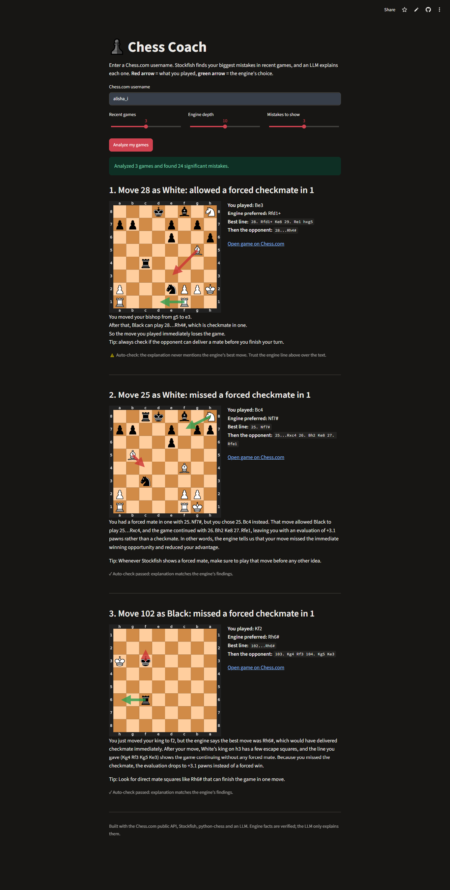

# Chess Coach

Enter a Chess.com username and get a plain-language review of your biggest mistakes in recent games.

**Live demo:** https://chess-coach-110.streamlit.app/



## Why I built it

Chess engines are great at saying *what* the best move is, but not *why*. LLMs are great at explaining, but they invent moves and squares when left to judge a position alone. Chess Coach combines the two: the engine supplies verified facts and the LLM turns them into a short explanation.

## How it works

1. **Data:** fetches recent games from the Chess.com public API (PGN).
2. **Analysis:** replays each game with `python-chess` and evaluates every one of your moves with Stockfish. The gap between the best move and the move you played is the mistake size.
3. **Grounded explanation:** for the biggest mistakes, the LLM receives the exact piece positions, the move played, the engine's best move and line, the opponent's best reply, and any forced mate. It is told to use only those facts.
4. **Auto-check:** a simple eval compares the explanation with the engine's findings (does it name the best move? does it mention mate only when a mate exists?) and shows a ✓ or ⚠️ under each explanation.
5. **Visuals:** each mistake is drawn on a board. Red arrow = what you played, green arrow = the engine's choice.

## What I learned

- My first version gave the LLM only a position and a score. It confused which side moved and invented squares. Giving it the piece list, the opponent's reply line and mate information fixed most of this.
- Mate scores are huge numbers, so a missed mate looked like "lost 10,000 centipawns". I now label those as "missed a forced checkmate in N".
- A cheap automatic check catches some bad explanations, but it can't prove an explanation is right. The engine line is always shown so you can verify.
- Streamlit caches results, so I version the cache to avoid showing stale output after code changes.

## Limitations

- Engine depth is kept low (default 10) so the free server stays fast. Deeper analysis would find subtler mistakes.
- It analyzes only your moves, and only a few recent games.
- It runs on free-tier hosting and a free-tier LLM, so it can be slow or rate limited.
- The LLM explanation can still be wrong. Trust the engine line over the text.

## Run it yourself

```bash
pip install -r requirements.txt
# install Stockfish (stockfishchess.org/download), then:
export STOCKFISH_PATH=/path/to/stockfish        # Windows PowerShell: $env:STOCKFISH_PATH="C:\path\stockfish.exe"
export LLM_BASE_URL=https://api.groq.com/openai/v1
export LLM_API_KEY=your_key
export LLM_MODEL=openai/gpt-oss-20b
streamlit run app.py
```

Command line version (engine only, no key needed):
```bash
python coach.py YOUR_USERNAME --games 3 --no-llm --stockfish /path/to/stockfish
```

Any OpenAI-compatible provider works (Groq, Google Gemini, OpenRouter). On Streamlit Community Cloud, put the three `LLM_*` values in Secrets; `packages.txt` installs Stockfish.

## Ideas for next steps

- Run a larger eval: score explanations against engine facts across hundreds of positions
- Group mistakes by theme (missed tactics, endgames, time trouble)
- Show non-mate mistakes first as an option, for more positional lessons
- Track improvement over time

## Credits

Chess.com public API, Stockfish, python-chess, Streamlit.
